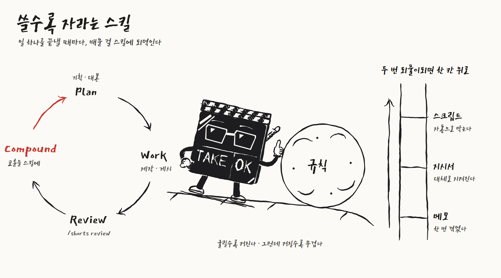

# /shorts — 주제 한 줄로 만드는 개발 개념 쇼츠

코드일지 유튜브 채널의 개발 개념 쇼츠를 [Claude Code](https://claude.com/claude-code) 스킬 하나로 만든다. 주제 한 줄을 주면 묻고(그릴링) → 기획안 → 녹음과 낙서 → 미리보기 → 렌더 → 업로드까지 이어 가고, 사용자는 기획안과 미리보기, 게시 정보만 승인한다.

## 무엇을 담나

- 영상은 지식이 아니라 **'왜'** 하나를 담는다. 기술 이름이 나오기 전에, 그 기술이 없을 때의 불편을 누구나 겪어 본 일상 장면으로 먼저 보여 준다. 코드는 쓰지 않는다.
- 한 편은 **30초 내외**, 다섯 박자(훅 → 불편 → 해결 → 이름 붙이기 → 남길 문장)다.
- 더 담을 것이 있는 주제는 **연작**으로 나눈다: 1편 왜 있나, 2편 실제 쓰임의 판단, 3편 함정이 생기는 까닭. 연작은 다 만든 뒤 한 번에 올려, 1편은 바로 공개하고 뒤 편은 하루씩 18:00에 예약한다.
- 그림은 SVG 펜 낙서, 나레이션은 Gemini TTS, 영상은 [HyperFrames](https://github.com/heygen-com/hyperframes) 컴포지션이다.

## 사용법

| 명령 | 하는 일 |
|---|---|
| `/shorts <주제>` | 새 쇼츠(또는 연작의 다음 편) 시작 |
| `/shorts` | 진행 상태 보기 |
| `/shorts complete` | 최종 검수·렌더·게시 정보 승인·업로드 |
| `/shorts review` | 제작 회고와 7일 뒤 눈길 지표 회고 |

## 열 단계

사람이 멈춰 서는 곳은 굵게 적은 세 번(기획안, 미리보기, 게시 정보)과 녹음 직전 확인뿐이다. 나머지는 Claude가 이어 간다. 지금까지 쇼츠 11편을 이 흐름으로 만들며 스킬을 키웠다.

| 단계 | 하는 일 | 누가 기다리나 |
|---|---|---|
| 1 기획 | 그릴링으로 묻고 대본판을 쓴다 | 사용자 답 |
| 2 기획안 승인 | 대본을 확정하고 러프 2~3개 중 하나를 고른다 | **사용자 승인** |
| 3 곡 받기와 녹음 | 곡 받기, TTS 녹음, 낙서 그리기를 동시에 | 녹음 직전 "네" |
| 4 애니메틱 | 움직임 표와 애니메틱을 보이고 바로 넘어간다 | 기다리지 않음 |
| 5 제작 | 레이어별로 나눠 만들고 합친다 | Claude |
| 6 미리보기 | 시각을 붙인 의견을 장면별로 고친다 | **사용자 의견** |
| 7 완성 | 최종 검수·렌더, 게시 정보 초안 | **사용자 "네"** |
| 8 업로드 | 비공개로 올린 뒤 공개·예약 | Claude |
| 9 썸네일 | 실패하면 여기서 다시 시도 | Claude |
| 10 게시 완료 | 기록 정리, 저작권 확인만 남김 | 사용자 확인 |

단계가 바뀌는 2→3, 4→5, 6→7에서 새 세션을 연다. 한 세션이 길어지면 컨텍스트가 압축되면서 앞에서 정한 것을 놓치기 때문이다.

## 폴더

| 경로 | 내용 |
|---|---|
| `SKILL.md` | 진입점: 분기, 단계 열 개, 그릴링 역할, 성장 고리, 모든 흐름에 걸리는 규칙 |
| `flows/` | 흐름별 절차: 시작(start), 그릴링(grill), 제작(make), 완성과 게시(complete), 회고(review), 상태(status) |
| `references/` | 영상마다 자라는 출발점: 교훈 요약(summary), 영상별 회고(history), 캐릭터(character). 가끔 가는 절차: 도구 스킬(tools), 곡 받기(music) |
| `scripts/` | 상태 기록 도우미(active), 속도 감시(pace), 구간 병렬 검사(check_parallel)와 테스트 |
| `evals/` | 손으로 돌리는 흐름 시나리오와 평가용 가짜 유튜브 클라이언트 |

## 네 층과 고치는 자리

스킬은 네 층으로 나뉜다. 자기 일에 맞게 고칠 때는 바꾸고 싶은 것이 어느 층인지부터 정한다.

| 층 | 파일 | 무엇을 바꾸나 | 이렇게 고친다 |
|---|---|---|---|
| 지시서 | `SKILL.md`, `flows/` | 단계 순서, 언제 묻고 언제 넘어가나 | 흐름 자체를 바꿀 때만 |
| 기본값·용어 | 작업 폴더의 `shorts-defaults.md`, `GLOSSARY.md` | 길이, 박자, 색, 말투 같은 채널 취향 | 가장 자주. 여기만 바꿔도 다른 채널 쇼츠가 된다 |
| 기록 | `references/summary.md`, `history.md`, `character.md` | 다음 영상의 출발점 | 직접 고치기보다 `/shorts review`가 쌓게 둔다 |
| 스크립트 | `scripts/`, 작업 폴더의 템플릿(`shorts-template/narration/tts_budget.py` 등) | 상태 기록, 시간 감시, 구간 병렬 검사, TTS 하루 한도 | 매번 같아야 하는 것, 지시서로는 자꾸 빠지는 것 |

## 이 스킬이 기대는 것 (이 저장소에는 없음)

스킬은 작업 폴더(video1)의 아래 파일과 함께 돌아간다. 여기에는 스킬만 올렸다.

- 제작 기본값 `docs/agents/shorts-defaults.md`, 용어집 `GLOSSARY.md`, 결정 기록 `docs/adr/`
- 게시 명령 `publish/`(YouTube Data API, 비공개로 올린 뒤 공개·예약), 게시 목록 `published.md`
- 영상 템플릿 `shorts-template/`, 낙서 도구와 규칙 `doodles/`, 곡 목록과 도구 `music/`
- 상태와 명세 `.scratch/`
- HyperFrames 공식 스킬(`hyperframes`, `hyperframes-cli`, `hyperframes-registry`, `media-use` 등): `npx hyperframes skills update`로 설치한다. 부르는 자리는 `references/tools.md`
- claude.ai 플러그인(선택): watch-video, anidoodle, Streamline Icons. 없으면 건너뛴다

## 자라는 방식

[compound engineering](https://every.to/guides/compound-engineering)의 Plan → Work → Review → **Compound** 고리를 따른다. 영상 하나를 만들고(Plan·Work), `/shorts review`로 돌아보고(Review), 배운 것을 스킬에 되먹인다(Compound). 되먹이는 순서는 `SKILL.md` "성장 고리"의 네 단계다.

1. **쌓기**: 만드는 동안 의견과 실패를 원본 기록(`references/history.md` 등)에 적는다.
2. **추리기**: 게시 완료와 회고 때 다음 영상이 읽을 출발점(`summary.md`, 50줄 안)으로 추린다. 파일을 통째로 다시 쓰지 않고 줄 단위로 더하고 고친다. 통째로 다시 쓰면 세부가 깎여 나간다([ACE](https://arxiv.org/abs/2510.04618)의 context collapse).
3. **올리기**: 같은 교훈이 두 영상에서 나오면 사용자 동의를 받아 규칙 문서로 올린다.
4. **비우기**: 규칙이 된 줄은 출발점에서 빼고, 원본 기록에 올린 곳을 적는다.

규칙으로 올려도 매번 지켜지지는 않는다. Claude Code 문서도 지시서는 "대부분 통하지만 매번은 아니다"라고 한다([best practices](https://code.claude.com/docs/en/best-practices)). 그래서 매번 같아야 하는 것은 한 칸 더 올려 스크립트로 막는다. TTS 하루 한도(`tts_budget.py`, 요청 전에 장부에 적고 넘으면 보내지 않음)와 구간 병렬 검사(`scripts/check_parallel.py`)가 이렇게 옮긴 것이다. 아직 hook은 쓰지 않는다.

같은 규칙은 한 곳에만 두고, 새 규칙을 올릴 때 부딪히는 옛 규칙도 함께 지운다. 두 지시가 모순되면 Claude는 아무 쪽이나 고를 수 있다([memory](https://code.claude.com/docs/en/memory)).

정답이 없는 취향(캐릭터, 썸네일)은 규칙으로 정하지 않는다. 시안마다 사용자 반응을 경우의 수 표에 쌓고, 통한 것만 `character.md`로 추려 다음 시안의 출발점을 옮긴다. 마지막 선택은 사람이 한다.

규칙 줄을 고치거나 더할 때는 막을 일보다 할 일("~한다")로 쓴다. 금지("~하지 않는다")는 되돌리기 어려운 일(게시, 내려받기, TTS 한도)의 문턱에만 할 일과 함께 남긴다. 금지를 적으면 그 행동이 오히려 떠오르기 때문이다.
